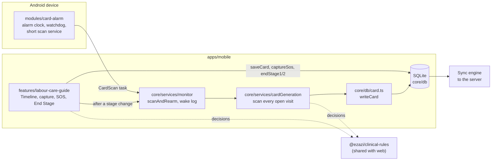
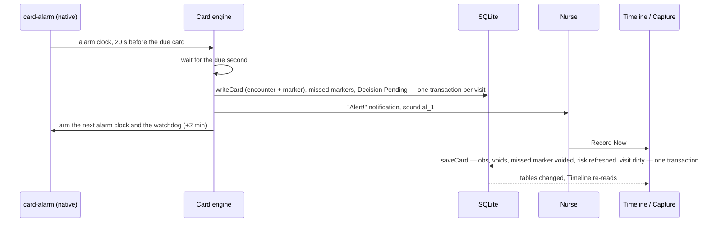
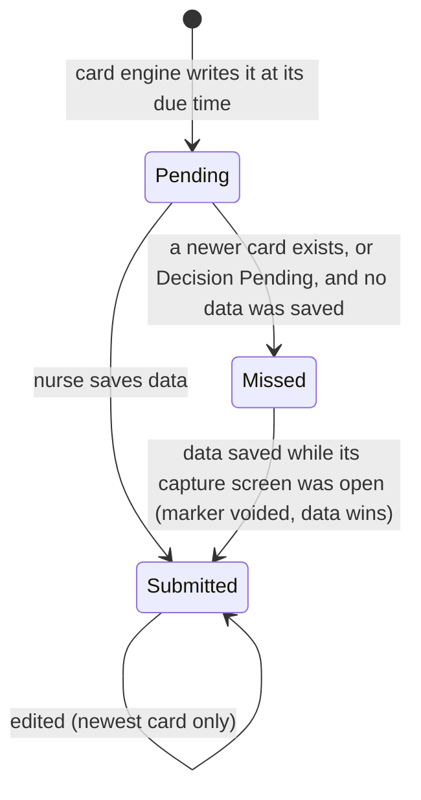
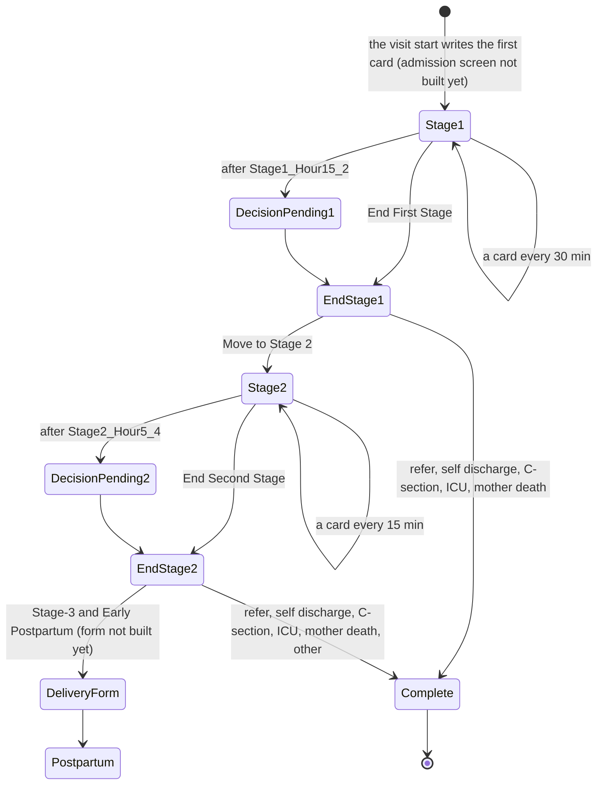

# Labour module architecture

The labour module turns one admitted woman's visit into a Timeline of observation cards. The card engine creates
each card at its due time, even with the app closed. A nurse captures it, and every save, SOS and End Stage is
written in one transaction from a decision the shared clinical-rules package makes. The rules for working in this
code are in [`LABOUR_CONVENTIONS.md`](LABOUR_CONVENTIONS.md); the reasons are in [`adr/`](adr/README.md).

## 1. What labour talks to

The package makes every clinical decision and touches nothing; the app performs it. Only `data/`, the card engine
and `writeCard` write to the database. Sync reads the rows the module marks dirty; labour never calls the server.
When the sync branch is merged, every obs and visit-attribute write goes through `core/useCases`, which marks the
parent dirty in the same transaction (`LABOUR_CONVENTIONS.md` §3).

## 2. A card's life

If the alarm clock's wake-up fails, the watchdog two minutes later creates the card. A scan that throws still
re-arms (`finally`), so the chain of alarms cannot end.

## 3. Card states

| State | Who can open it | Access |
|---|---|---|
| Pending (newest, no data) | The visit holder | Write |
| Submitted, newest | The visit holder | Edit (edit marker shown) |
| Submitted, older | The visit holder | Read only |
| Missed | Nobody | None |
| Any card of a completed visit | Nobody | None |

The rule is `getCardStatus` in `@ezazi/clinical-rules` (`cards/cardStatus.ts`).

## 4. A visit's life

A completed visit shows its outcome line instead of End Stage and the quick actions, and is completed only once.
After any End Stage that changes the stage, the alarms are re-armed for the new stage.

## 5. Where each concern lives

| Concern | Layer | File |
|---|---|---|
| When the next card is due, Decision Pending | Package | `decideNextStep` |
| Card state and access | Package | `getCardStatus` |
| Fields, options, ranges, alert codes, save rows | Package | `getCardLayout`, `buildNewCardObs`, `buildEditedCardObs` |
| SOS, End Stage outcomes, visit risk | Package | `decideSos`, `decideEndStage1`, `decideEndStage2`, `computeVisitRisk` |
| Writing a card | App, core | `core/db/card.ts` |
| Creating due cards for every visit | App, core | `core/services/cardGeneration/scan.ts` |
| Waking up on time | Native + app | `modules/card-alarm`, `core/services/monitor` |
| Saving, SOS, End Stage | App, labour Model | `data/labourRepository.ts` |
| What a screen shows, and when it re-reads | App, labour ViewModel | `stores/` |
| Drawing | App, labour View | `screens/`, `components/` |

## 6. When something fails

| Failure | What happens | Where |
|---|---|---|
| A card save fails | "Not saved" dialog; the card stays open with its input | `useCaptureFormViewModel`, `CardCaptureScreen` |
| A scan throws | Logged and written to the wake log; the alarms are re-armed anyway; the next try is in a minute | `cardScheduler.ts` |
| One visit fails during a scan | Logged and skipped; the other visits still get their cards | `cardGeneration/scan.ts` |
| The alarm clock's wake-up never runs | The watchdog alarm two minutes later creates the card | `modules/card-alarm` |
| The battery check finds a card more than 3 s overdue | It creates it | `cardScanTask.ts` |
| An End Stage write fails | Logged; nothing is half-written (one transaction). The dialog closes **with no message** and the nurse stays on the Timeline: open point 24 | `useTimelineViewModel`, `TimelineScreen` |
| A second End Stage on a completed visit | Refused as `alreadyCompleted` | `labourRepository.ts` |

## 7. Extending the module

- **A new field or rule:** in the package first (additively, with its Android source cited), then its view in
  `domain/captureFieldView.ts`; screens pick it up from the layout.
- **A new stage (the delivery form, Stage 4):** a decision in the package, a writer in `data/`, a ViewModel in
  `stores/`, screens last; re-arm after any write that changes the stage.
- **A new client's ranges:** a range profile in the package (`ARCHITECTURE_RULES.md` §7a), never a branch in the app.
